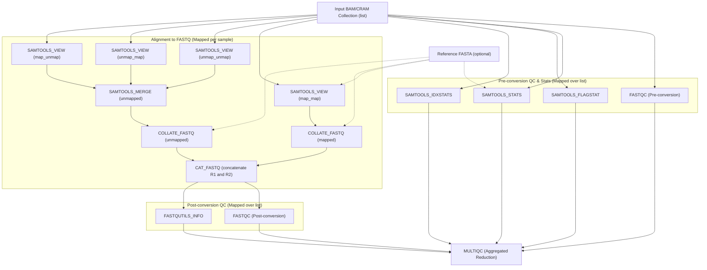

# Nextflow to Galaxy Data-Flow Brief: nf-core/bamtofastq

## Abstract Pipeline Topology

The pipeline consists of three core functional stages:
1. **Pre-conversion Quality Control & Statistics**: Computes quality metrics and alignment statistics on the input BAM/CRAM files.
2. **Alignment Partitioning & FASTQ Conversion**: Partitions mapped and unmapped read pairs, converts them to FASTQ via collate/fastq, and concatenates corresponding pairs to yield complete sample FASTQ datasets.
3. **Post-conversion Quality Control & Reporting**: Evaluates extracted FASTQs and summarizes all pipeline metrics in a global MultiQC report.

## Detailed Data-Flow Operations

### 1. Pre-conversion Quality Control (Mapped)
- **FASTQC_PRE**:
  - Input: `input_bams` (collection mapping over `list`).
  - Output: Pre-conversion FastQC HTML reports (`list`) and raw data ZIPs (`list`).
- **SAMTOOLS_STATS**:
  - Input: `input_bams` (collection mapping over `list`), optional `reference_fasta`.
  - Output: Samtools stats reports (`list`).
- **SAMTOOLS_FLAGSTAT**:
  - Input: `input_bams` (collection mapping over `list`).
  - Output: Flagstat metrics (`list`).
- **SAMTOOLS_IDXSTATS**:
  - Input: `input_bams` (collection mapping over `list`).
  - Output: Idxstats table (`list`).

### 2. Alignment to FASTQ Conversion (Mapped per Sample)
- **SAMTOOLS_VIEW (Partitioning)**:
  - `map_map`: Filters reads with flags `-f 1 -F 12` (paired, both mapped).
  - `unmap_unmap`: Filters reads with flags `-f 13` (paired, both unmapped).
  - `unmap_map`: Filters reads with flags `-f 5 -F 8` (paired, read1 unmapped, read2 mapped).
  - `map_unmap`: Filters reads with flags `-f 9 -F 4` (paired, read1 mapped, read2 unmapped).
- **SAMTOOLS_MERGE**:
  - Combines the 3 unmapped partitions (`unmap_unmap`, `unmap_map`, `map_unmap`) into a single unmapped alignment dataset per sample.
- **SAMTOOLS_COLLATEFASTQ**:
  - Executed on mapped reads (`map_map`) -> outputs mapped R1 & R2 FASTQs.
  - Executed on merged unmapped reads -> outputs unmapped R1 & R2 FASTQs.
- **CAT_FASTQ**:
  - Concatenates mapped R1 + unmapped R1 -> `<sample>_1.merged.fastq.gz`.
  - Concatenates mapped R2 + unmapped R2 -> `<sample>_2.merged.fastq.gz`.
  - Emits paired read collection (`list:paired`) or forward/reverse collections per sample.

### 3. Post-conversion Quality Control (Mapped)
- **FASTQC_POST**:
  - Runs FastQC on the extracted FASTQ read pairs.
  - Output: Post-conversion FastQC HTML and data ZIP collections.
- **FASTQUTILS_INFO**:
  - Runs fastqutils info to verify read formatting, counts, and integrity.
  - Output: Text reports per sample (`list`).

### 4. Global MultiQC Reduction
- Inputs: Gathers all outputs from `FASTQC_PRE`, `SAMTOOLS_STATS`, `SAMTOOLS_FLAGSTAT`, `SAMTOOLS_IDXSTATS`, `FASTQC_POST`, and `FASTQUTILS_INFO`.
- Output: Single aggregated `multiqc_report.html` dataset.

## Tool Requirements
1. `fastqc` (IUC wrapper `toolshed.g2.bx.psu.edu/repos/devteam/fastqc/fastqc`)
2. `samtools_stats` (IUC wrapper `toolshed.g2.bx.psu.edu/repos/devteam/samtools_stats/samtools_stats`)
3. `samtools_flagstat` (IUC wrapper `toolshed.g2.bx.psu.edu/repos/devteam/samtools_flagstat/samtools_flagstat`)
4. `samtools_idxstats` (IUC wrapper `toolshed.g2.bx.psu.edu/repos/devteam/samtools_idxstats/samtools_idxstats`)
5. `samtools_view` (IUC wrapper `toolshed.g2.bx.psu.edu/repos/iuc/samtools_view/samtools_view`)
6. `samtools_merge` (IUC wrapper `toolshed.g2.bx.psu.edu/repos/devteam/samtools_merge/samtools_merge`)
7. `samtools_collatefastq` (or `samtools_fastx` / author user-defined tool if collate-fastq pipeline is encapsulated)
8. `cat_fastq` (or coreutils `cat` / `cat_queries`)
9. `fastqutils_info` (ngsutils/fastqutils or UDT)
10. `multiqc` (IUC wrapper `toolshed.g2.bx.psu.edu/repos/iuc/multiqc/multiqc`)
